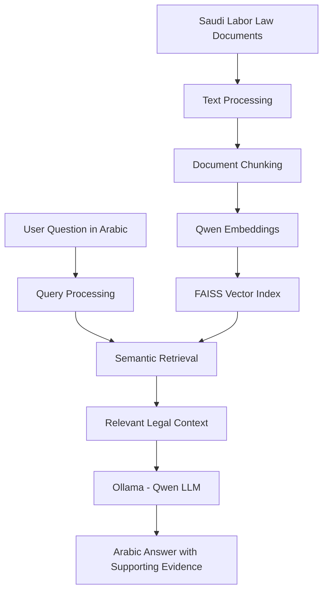

# Saudi Labor Law – Arabic RAG Application

An Arabic AI-powered application that uses **Retrieval-Augmented Generation (RAG)** to retrieve, analyze, and answer questions about the Saudi Labor Law using relevant legal provisions as supporting evidence.

The project combines semantic search, vector-based retrieval, and locally hosted Large Language Models (LLMs) to provide context-grounded answers based on retrieved legal documents.

## Overview

Understanding legal regulations often requires searching through lengthy documents and identifying the specific articles relevant to a particular question.

This project addresses that challenge by building a Retrieval-Augmented Generation system that enables users to ask questions in Arabic and retrieve relevant provisions from the Saudi Labor Law.

Instead of relying solely on the language model's internal knowledge, the application retrieves relevant legal content and uses it as context for generating answers.

## Key Features

- **Arabic Question Answering:** Ask questions about Saudi Labor Law using natural Arabic language.
- **Retrieval-Augmented Generation (RAG):** Combines document retrieval with LLM-based answer generation.
- **Semantic Search:** Retrieves relevant legal content based on the meaning and context of user queries.
- **Vector Search:** Uses FAISS for efficient similarity-based document retrieval.
- **Arabic Text Processing:** Processes and organizes Arabic legal documents into searchable chunks.
- **Source-Grounded Responses:** Generates answers using retrieved legal provisions to support response accuracy and traceability.
- **Local LLM Integration:** Uses Ollama to run language models locally without relying on external LLM APIs.

## System Architecture

The application follows a Retrieval-Augmented Generation workflow:

1. **Document Preparation:** Legal articles are collected, cleaned, and structured.
2. **Text Chunking:** Documents are divided into smaller text segments to improve retrieval.
3. **Embedding Generation:** Qwen embedding models convert text chunks into vector representations.
4. **Vector Indexing:** FAISS stores and indexes embeddings for efficient similarity search.
5. **Query Processing:** User questions are processed and converted into embeddings.
6. **Context Retrieval:** Relevant legal passages are retrieved from the vector index.
7. **Answer Generation:** A locally hosted LLM uses the retrieved context to generate an Arabic response.

### RAG Workflow



## Technology Stack

| Component | Technology |
|---|---|
| Programming Language | Python |
| RAG Framework | Retrieval-Augmented Generation |
| Language Model | Qwen 3 (8B) |
| Embedding Model | Qwen3-Embedding (0.6B) |
| Vector Database / Index | FAISS |
| Local Model Runtime | Ollama |
| Backend | Flask |
| Interface | HTML, CSS, JavaScript |

## Project Structure

```text
labor-law-rag/
│
├── app/                  # Application interface and web components
│
├── segment/              # Document segmentation and related resources
│
├── src/                  # Core application modules
│
├── build_faiss.py        # FAISS index construction
├── generateJSONL.py      # Dataset preparation and JSONL generation
├── rag_query.py          # RAG query execution
│
├── chunks.jsonl          # Processed document chunks
├── metadata.jsonl        # Document metadata
├── faiss_index.bin       # FAISS vector index
│
├── requirements.txt      # Python dependencies
└── README.md
```

## Installation & Setup

### 1. Clone the Repository

```bash
git clone https://github.com/ShaimaHamdan/labor-law-rag.git
cd labor-law-rag
```

### 2. Create a Virtual Environment

```bash
python -m venv venv
```

Activate the environment:

**Windows:**
```bash
venv\Scripts\activate
```

**Linux / macOS:**
```bash
source venv/bin/activate
```

### 3. Install Dependencies

```bash
pip install -r requirements.txt
```

### 4. Install and Configure Ollama

Download and install Ollama:

https://ollama.com/

Pull the required models:

```bash
ollama pull qwen3:8b
ollama pull qwen3-embedding:0.6b
```

Ensure Ollama is running before starting the application.

### 5. Run the Application

Run the Flask application using its configured entry point.

The application requires the processed document data, FAISS index, and locally available Ollama models.

## Data Source

The project is based on the Saudi Labor Law published by the Saudi Ministry of Human Resources and Social Development (HRSD).

Official source:

https://www.hrsd.gov.sa/

The document collection contains structured legal articles and associated metadata used for retrieval and answer generation.

## Design Considerations

- **Grounded Generation:** Answers are generated using retrieved legal context rather than relying exclusively on model-generated knowledge.
- **Retrieval Relevance:** Semantic retrieval helps identify legal provisions related to the user's question.
- **Local Execution:** Local model inference supports data control and reduces dependence on external AI APIs.
- **Traceability:** Retrieved legal provisions provide supporting context for generated responses.

## Limitations

- The quality of generated answers depends on the relevance and completeness of retrieved legal documents.
- The application is an experimental AI-assisted legal information tool and does not replace professional legal advice.
- Generated responses should be verified against the official Saudi Labor Law and its latest amendments.
- Local execution requires sufficient computational resources for the selected language and embedding models.

## Future Improvements

- Improve hybrid retrieval by combining semantic similarity with Arabic keyword matching.
- Enhance legal citation and source-link generation.
- Expand retrieval evaluation using relevant legal question-and-answer datasets.
- Improve response latency and retrieval efficiency.
- Extend the document collection to include additional official regulations and amendments.

## Author

**Shaima Alharbi**

Data Science | Artificial Intelligence | Generative AI | NLP

GitHub: [ShaimaHamdan](https://github.com/ShaimaHamdan)

---

*This project was developed as an applied exploration of Retrieval-Augmented Generation, Arabic NLP, vector search, and locally hosted Large Language Models.*
